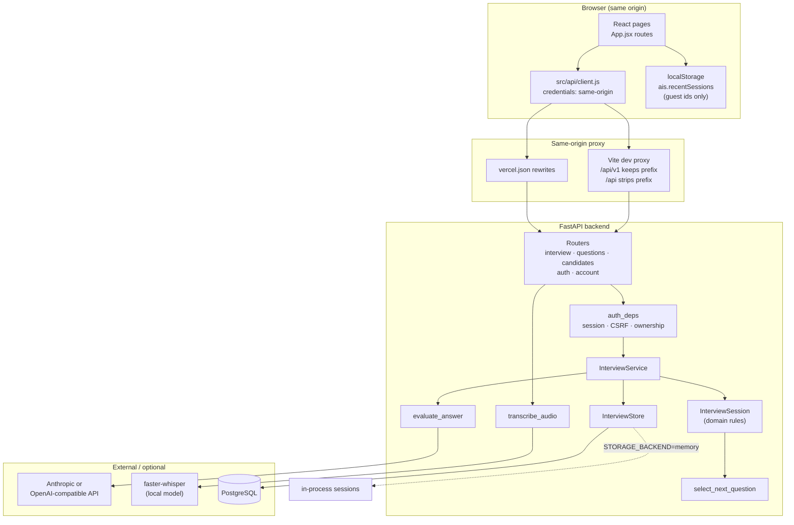
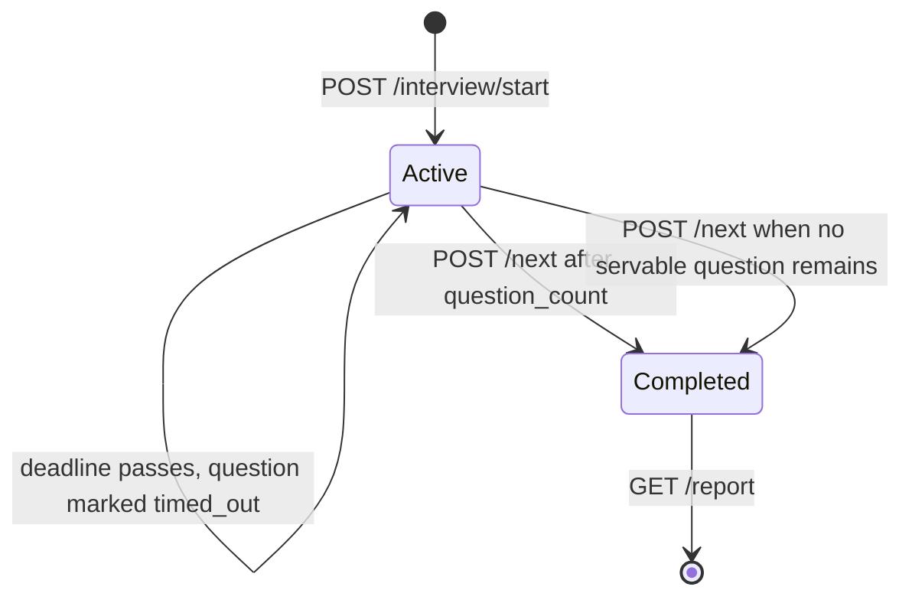
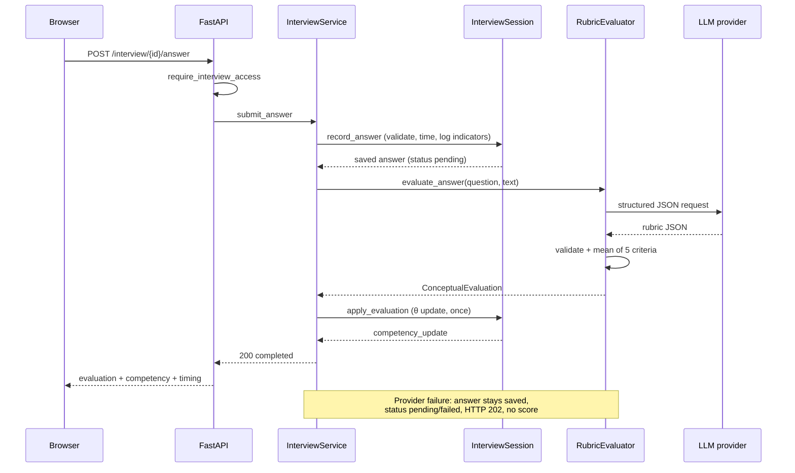
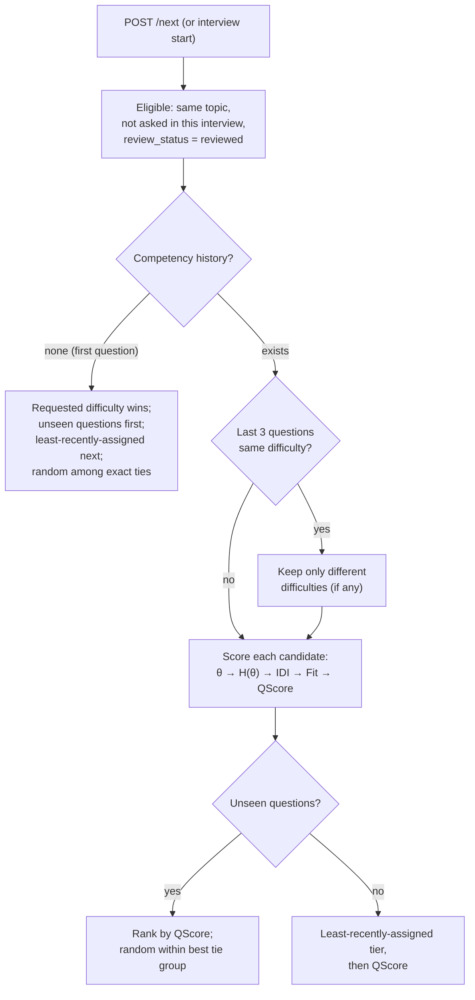
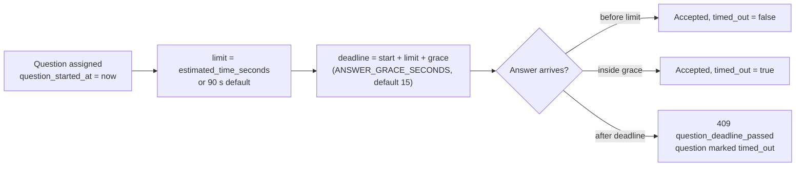
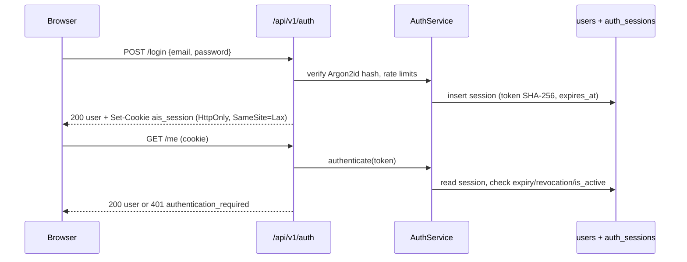

# System Architecture

This document describes the system that exists in this repository. Where something is
planned rather than built it is labelled **Not implemented**. Endpoint-level detail lives in
[API.md](API.md); persistence in [DATABASE.md](DATABASE.md); the adaptive mathematics in
[MATHEMATICAL_SPEC.md](MATHEMATICAL_SPEC.md).

## 1. Components

| Component | Location | Responsibility |
| --- | --- | --- |
| React SPA | `backend/frontend/` | Setup, interview, report, accounts, dashboard; timer, recording, integrity capture |
| FastAPI app | `backend/app/main.py` | Routers, middleware, health, exception mapping |
| API layer | `backend/app/api/` | Validation, dependencies (session/CSRF/ownership), HTTP error mapping |
| Interview service | `backend/app/services/interview_service.py` | One API operation per call, inside a per-interview transaction |
| Interview domain | `backend/app/services/interview_engine.py` | All interview rules: answers, timing, integrity, competency, progression |
| Question selector | `backend/app/services/question_selector.py` | Cold start, adaptive ranking, cooldown rotation, anti-streak |
| Adaptive metrics | `backend/app/services/adaptive_metrics.py` | Pure θ → H → IDI → Fit → QScore functions |
| Evaluators | `backend/app/services/rubric_evaluator.py`, `llm_providers.py` | Structured rubric scoring through a pluggable LLM provider |
| Transcription | `backend/app/services/transcription_service.py`, `whisper_provider.py` | Audio → text, timeout, typed errors |
| Stores | `backend/app/services/interview_store.py`, `backend/app/db/postgres_store.py` | Load/persist an interview transactionally |
| Question bank | `backend/data/question_bank.json` (generated from `.csv`) | 827 questions with review status and rubric metadata |

## 2. System diagram



## 3. Backend layering

The layering is strict and one-directional:

```text
HTTP router → dependencies → InterviewService → InterviewStore → InterviewSession (domain)
                                     ↘ evaluators / selector / transcription
```

- **Routers** (`api/interview.py`, `api/auth.py`, …) never contain interview rules. They
  validate with Pydantic, call a service and translate domain exceptions through
  `api/errors.py`.
- **Dependencies** (`api/auth_deps.py`) decide who may reach a resource and enforce CSRF on
  cookie-authenticated state changes.
- **InterviewService** wraps every operation on an existing interview in
  `store.edit(interview_id)`, which takes an exclusive lock (`SELECT … FOR UPDATE NOWAIT` on
  the interview row in PostgreSQL, an `RLock` in memory). Starting an interview instead locks
  the candidate row, so two concurrent starts for one candidate see each other's question
  history. Together these make "one answer, one evaluation, one competency update" hold under
  concurrent requests.
- **InterviewSession** owns every rule: accept or refuse an answer, compute timing, log
  integrity events, update competency, advance or complete. It is storage-agnostic and
  records `Change` objects (`services/domain_changes.py`) that a store persists.
- **Stores** load one interview, run the domain operation in a transaction and write back
  the recorded changes. No formula is duplicated in the PostgreSQL layer.

## 4. Interview lifecycle



Per question the server exposes one of five `question_state` values, used by the frontend to
decide what to show (`active` has an in-grace variant, shown as its own row):

| State | Meaning | `next_action` |
| --- | --- | --- |
| `active` | Waiting for an answer, deadline not passed | `answer` |
| `active`, inside the grace period | Late but still accepted | `answer` |
| `evaluation_pending` | Answer saved, evaluator unavailable, retries left | `retry_evaluation` (then `advance`) |
| `evaluation_failed` | Evaluator output unusable, retries left | `retry_evaluation` (then `advance`) |
| `evaluated` | Scored; competency updated once | `advance` |
| `timed_out` | Deadline passed with no accepted answer | `advance` |

A question is closed exactly once. A second answer is `409`; an answer after
`limit + grace` is `409 question_deadline_passed` and the question is marked timed out.
Evaluation failures never lose the saved answer and never invent a score.

## 5. Answer and evaluation pipeline



The overall score is **computed by the backend** as the rounded mean of five integer
criteria (technical accuracy, relevance, completeness, depth, clarity); the model's own
"overall" opinion is not requested. `scenario`, `system_design` and `debugging` answers use
the same rubric evaluator as `conceptual`. Coding questions would use
`services/coding_evaluator.py`, but no test cases exist and those questions are never
selected.

## 6. Adaptive question selection

Cold start and adaptive mode are separate paths:



Verified constants: `EMA_ALPHA = 0.15` (`schemas/competency.py`), equal QScore weights 0.5/0.5
and difficulty values 0.25/0.50/0.75 (`services/adaptive_metrics.py`), `STREAK_LIMIT = 3`
(`services/question_selector.py`). Competency state is owned by one interview and starts at
0.5 per competency, so θ is **not comparable across interviews** — it is reset when a new
interview begins. Full formulas, worked examples and limitations:
[MATHEMATICAL_SPEC.md](MATHEMATICAL_SPEC.md).

Candidate-aware cooldown reads `interview_questions` rows (PostgreSQL) or existing sessions
(in memory) for the same `candidate_id` and topic; anonymous interviews have no history. See
[decisions/0005-candidate-aware-cooldown.md](decisions/0005-candidate-aware-cooldown.md).

## 7. Timing and integrity



- The server clock is the only clock. Client timestamps and `submission_reason` are stored
  as metadata and never decide whether a timeout occurred.
- `question_started_at` is set once per question and is never reset by a resubmission.
- Client integrity events (`copy`, `paste`, `tab_switch`, `focus_loss`, `focus_gain`) are
  stored verbatim with no clipboard content. Server indicators
  (`late_submission_rejected`, `duplicate_submission`, `unassigned_question_attempt`,
  `fast_submission`) are recorded independently.
- Integrity events never block, penalise or rescore an answer. They appear in the report as
  counts for human review.

## 8. Authentication and ownership



Guest interviews stay open by id. An interview owned by an account requires that account's
session: guests get `401`, other accounts get `404` (never `403`, so existence is not
confirmed). A client-supplied `candidate_id` is never authentication. Details, including the
deliberately unimplemented guest-claiming design: [AUTHENTICATION.md](AUTHENTICATION.md).

## 9. Frontend architecture

React 19 + Vite SPA with client-side routing. `SessionProvider` asks the server who is signed
in and exposes `useSession()`; `src/api/client.js` is the only place that performs HTTP.
Interview and report routes are deliberately unguarded so guest links keep working; only
`/dashboard` is protected. Full route and component map: [FRONTEND.md](FRONTEND.md).

## 10. Error handling

Three error body shapes reach the client:

```jsonc
{ "detail": "Interview not found" }                              // legacy routes
{ "detail": { "code": "csrf_rejected", "message": "..." } }      // newer routes
{ "detail": [ { "loc": ["body", "topic"], "msg": "..." } ] }      // 422 validation
```

`api/errors.py` maps known domain exceptions and returns nothing else: raw exception text,
stack traces, provider bodies and database messages never leave the process. Unknown
exceptions become a plain 500. Every `/api/v1/*` response, including errors, carries
`Cache-Control: no-store` and `Pragma: no-cache`.

Domain specifics:

| Exception | Status | Body |
| --- | --- | --- |
| `InterviewNotFoundError` | 404 | `Interview not found` |
| `CandidateNotFoundError` | 404 | `Candidate not found` |
| `InterviewNotActiveError` | 409 | `Interview is not active` |
| `AnswerAlreadySubmittedError` | 409 | `This question has already been answered` |
| `QuestionNotCurrentError` | 400 | `This question is not the interview's current question` |
| `QuestionNotAnsweredError` | 409 | `The current question must be answered before moving on` |
| `UnsupportedQuestionTypeError` | 400 | `Unsupported question type` |
| `QuestionDeadlinePassedError` | 409 | `question_deadline_passed` |
| `EvaluationPendingError` | 409 | `evaluation_pending` |
| `AnswerNotFoundError` | 409 | `no_answer_recorded` |
| `EvaluationRetriesExhaustedError` | 409 | `evaluation_retries_exhausted` |
| `InterviewBusyError` | 409 + `Retry-After: 1` | `interview_busy` |
| `AuthError` subclasses | 401 / 403 / 409 / 429 | see [AUTHENTICATION.md](AUTHENTICATION.md) |

## 11. External integrations

| Integration | Status | Notes |
| --- | --- | --- |
| Anthropic Messages API | Implemented, not exercised live in this repository | Forced tool call; key from `ANTHROPIC_API_KEY` |
| OpenAI-compatible Chat Completions | Implemented, not exercised live in this repository | JSON mode; needs `OPENAI_MODEL` |
| `faster-whisper` | Implemented, optional install | Local model downloaded on first use; audio never leaves the server |
| PostgreSQL | Implemented | Selected by `STORAGE_BACKEND=postgres`, or by `DATABASE_URL` when `STORAGE_BACKEND` is unset |
| Email, payments, analytics | Not implemented | No integration exists |

There are no background workers, queues or scheduled jobs. Evaluation and transcription run
inline in the request that triggers them, which is why their timeouts are part of the request
budget.

Live calls to the two LLM providers are not covered by the automated suite (no key is
available); request and response shapes are tested with mocked HTTP. Treat provider
compatibility as requiring verification before production use.

## 12. Known architectural limitations

- Storage is synchronous SQLAlchemy inside FastAPI's threadpool; there is no async DB path.
- Rate limiting is in-process, so it multiplies per worker and resets on restart.
- The backend cannot observe a browser countdown, clipboard, tab switch or focus. Everything
  in that category is client-reported and only an indicator.
- A transcription worker thread cannot be cancelled on timeout; it finishes in the
  background.
- Reports and candidate-history routes are protected only for account-owned records; a guest
  record is readable by anyone holding its id (existing contract, documented in
  [AUTHENTICATION.md](AUTHENTICATION.md)).
